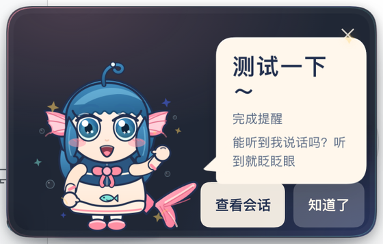

# dsh-fishgirl-notify · 肥鱼娘完成提醒

[](https://awesome-dsh-plugin.com/p/newpage1/dsh-fishgirl-notify/)

DSH 顶层会话完成一轮任务时：

- 向手机推送「肥鱼娘」通知（**飞书群机器人 / 飞书应用 / ntfy / Web Push** 多通道，可插拔、失败自动降级）；
- 在 Web 页面内播放肥鱼娘「做好啦～」动效弹窗。

任何通道失败都不阻塞会话；子代理回合不触发。



## 安装

```sh
# 从 GitHub 直接安装（DSH >= 0.2.1-rc.2）
dsh plugin --profile web add github:newpage1/dsh-fishgirl-notify

# 或从本地目录安装
dsh plugin --profile web add /absolute/path/to/dsh-fishgirl-notify
```

安装后如果页面还没有肥鱼娘按钮，重启一次 `dsh web`（宿主按包名缓存插件模块）。

## 配置

打开 DSH Web → 设置 → Web 插件 → **完成提醒**（或点击页面右下角的肥鱼娘按钮）：

- **飞书群机器人**：填 webhook（全平台，鸿蒙首选）
- **飞书应用**：填 App ID / App Secret / 接收方 ID（open_id 或 chat_id）
- **ntfy**：填 server 与 topic（鸿蒙需卓易通；无系统级推送）
- **Web Push**：Android/桌面 Chrome，点击订阅
- 页内动效默认开启；「只在本页测试」可随时预览

各通道的详细申请步骤见 **[docs/使用说明.md](docs/使用说明.md)**。

## 快速上手

```
# 自测（零外网依赖，34 项断言）
node test/run-tests.mjs

# 安装（DSH >= 0.2.1-rc.2）
dsh plugin --profile web add github:newpage1/dsh-fishgirl-notify
```

配置与手机授权（鸿蒙/Android/iOS）见 **docs/使用说明.md**。

## 结构

```
dsh-fishgirl-notify/
├── package.json          # 无运行时依赖；dsh.bundle.patch + dsh.client
├── cordis.patch.yml      # bundle 插入行（含全部默认配置）
├── index.js              # 宿主入口：session/event → notifier → 通道
├── client.js             # 客户端入口：页内弹窗 + 设置卡（React.createElement 单文件）
├── icon.svg / locale/    # 图标与中英文案
├── assets/               # 肥鱼娘素材（t3 产出）+ fishgirl-animation.css
├── lib/
│   ├── config.js         # 默认值 + 归一化（非法回退 + issue）
│   ├── notice.js         # 通知组装（文案模板/合并 ×N/clickUrl）
│   ├── notifier.js       # 事件管线（过滤/去抖/静默/降级/SSE）
│   ├── router.js         # /api/finish-notify/*（state/stream/secrets/test/…）
│   ├── store.js          # secrets/vapid/subscriptions 持久化（0600 原子写）
│   ├── logger.js         # 脱敏日志
│   ├── channels/         # feishu / feishu-app / ntfy / webpush + registry（可插拔）
│   └── webpush/          # VAPID ES256 + RFC8291 aes128gcm（纯 node:crypto）
└── test/run-tests.mjs    # 无网络自测
```

## 通道

| 通道 | 平台 | 凭证 | 备注 |
| --- | --- | --- | --- |
| feishu | 全平台（鸿蒙首选） | 群自定义机器人 webhook | interactive 卡片，被拒自动降级 text |
| feishu-app | 全平台（有飞书即可） | 自建应用 App ID/Secret + 接收方 ID | 免建群直发（v2.3 基础版）；token 内存缓存；卡片降级 text |
| ntfy | 鸿蒙（卓易通）/安卓 | topic（12 位随机）+ 可选 token | 公共 ntfy.sh 或自建 |
| webpush | Android/桌面 Chrome | VAPID（自动生成）+ 订阅 | 鸿蒙/iOS-浏览器不支持；410 自动清理 |
| inpage | 页面 | 无 | 始终启用（SSE 广播 + ?finish= 回放） |

## 与技术方案的偏差

- 未导出 schemastery `Config`（依赖不可达）：配置走 patch `config:` + 数据目录 `config.json` 覆盖 + 默认值，接口一致；
- `channelOrder` 默认 `[feishu, ntfy, webpush]`（feishu-app 需手动加入；registry 对未知通道 id 记 debug 跳过）；
- feishu webhook 校验额外放行本机回环地址（自建网关/本地测试）；
- 技术方案 v2.3 已并入 feishu-app 基础版（§7.6）：`image_key` 大图/自定义头像仍留 V1.5。

MIT。
