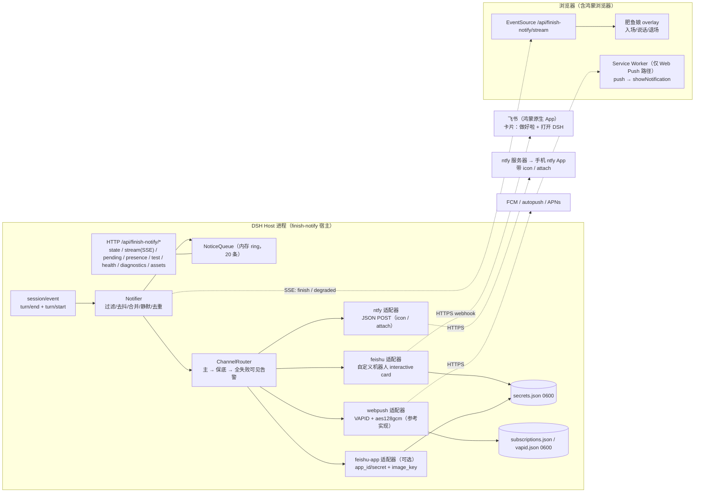
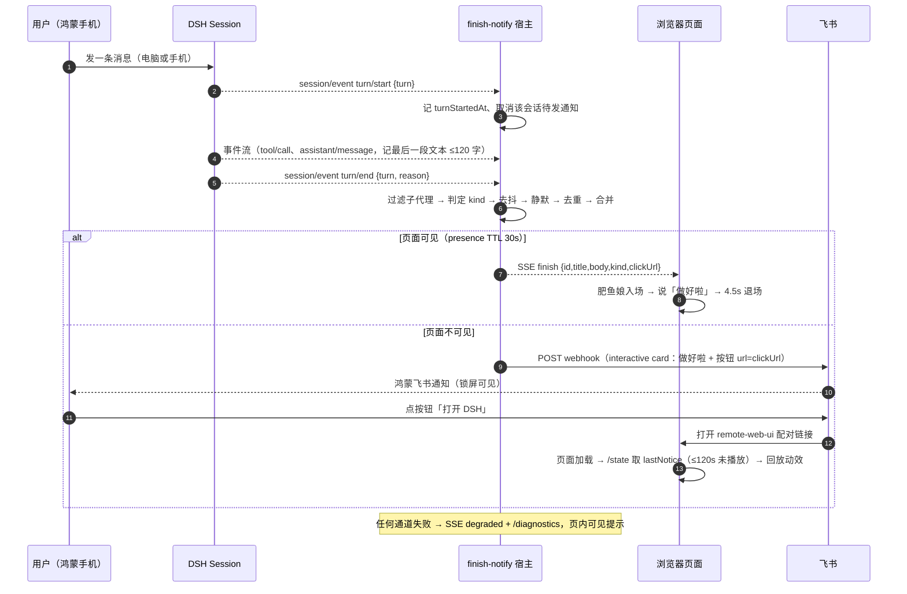

# DSH 完成提醒（肥鱼娘「做好啦」）技术方案

- 版本：**v2.2**（2026-11-06；v2 按「用户手机 = 鸿蒙 HarmonyOS NEXT」重写通道选型，v2.1 起 `ntfy` 升为 V1 通道，v2.2 并入设计师 t2 的 6 个接口点）
- 作者：架构师（AgentTeams / dsh-finish-notify）
- 状态：待实现（开发者按本方案实现，审查者按本方案核对一致性）
- 交付目录：`/Users/hexiaoying/workspace/dsh-finish-notify`
- 目标环境：DSH `0.2.1-rc.2`，profile `web`（`/Users/hexiaoying/.dsh/profiles/web`），Node `^22.19.0 || >=24`，单用户本机。

### 变更记录

| 版本 | 变更 |
|---|---|
| v1 | 初版：Web Push 为主 + 飞书/Bark 保底 |
| **v2** | **用户真机为鸿蒙 NEXT：Web Push 完全不可用**。主通道改为**飞书自定义机器人**；Web Push 降为「参考实现 + Android 模拟器验证」；新增 `feishu-app` 升级适配器（可上传图片/自定义头像）；补充鸿蒙真机验证与「大图」两条升级路径 |
| **v2.1** | 用户要求「飞书 + 推送 App 两条路并行」：`ntfy` 从扩展位升为 **V1 通道**（与 `feishu` 并列，`channelOrder` 默认 `['feishu','ntfy','webpush','feishu-app']`，其中 `feishu-app` 默认未配置、自动跳过），补齐 ntfy 载荷映射、健康检查、降级与重试；明确素材交付归设计师 t3（`notify-card.png`、`icon-192.png`、`icon-512.png`），避免下游重复生成 |
| **v2.2** | 并入设计师 t2 的 6 个接口点：① 回跳 URL 统一追加 `finish=<noticeId>`（新增 §4.1 `buildClickUrl`，三通道共用，显式点开可强制重播）；② 新增 `pagePopupEnabled`；③ `suppressPushWhenVisible`/`quietSuppressPush` 语义覆盖**所有手机通道**；④ `channelOrder` 命名对齐 `webpush`、`bark` 不默认（顺序意图不变）；⑤ `{errorCode}` 只渲染短词映射，`error.message` 只进诊断；⑥ 新增 `includeSummary`（默认 false，仅手机通道，命中代码/路径/密钥整段省略） |
| **v2.3** | t7 落地 `feishu-app` **基础版**（§7.6，原计划 V1.5 提前）：`tenant_access_token` 内存缓存 + 提前 300s 刷新、99991663/99991661 清缓存重试一次、interactive card（复用 §7.2 卡片）+ 降级 text、clickUrl 仅 https 公网、appId/receiveId 掩码末 4 位、appSecret 永不回显；新增配置 `feishuAppReceiveIdType`/`feishuAppReceiveId`/`feishuAppUseCard`（`feishuAppEnabled` 原有，默认仍 false 不进默认 channelOrder）；registry 支持 `enabledKey` 解连字符 id 与驼峰开关。`image_key` 大图/自定义头像仍留 V1.5 |

---

## 0. 一句话结论

宿主插件订阅 `session/event` 的 `turn/end`，把「回合结束」折叠成 `FinishNotice`；**同源 SSE** 驱动页内「肥鱼娘说做好啦」动效；页面不在前台时经**可插拔通道**发到手机。

**默认主通道 = 飞书自定义机器人**（鸿蒙 NEXT 有飞书原生版、只需一个 webhook、国内最稳、不依赖 Google/APNs/PWA）；**并列 V1 通道 = `ntfy`**（「推送 App」路线的落地：不依赖 FCM、可自建、支持自定义 `icon` 与 `attach` 图片；鸿蒙上经「卓易通」兼容层装 Android 版 ntfy，属尽力而为，飞书仍是默认与保底）；**Web Push = 参考实现**（Android 模拟器/桌面可验证，鸿蒙无 Push API，仅作能力储备与降级链路）；**`feishu-app` = 应用直发通道（基础版已落地，§7.6；`image_key` 大图/自定义头像留 V1.5）**；鸿蒙原生 App + Push Kit 列为 V2。

所有通道实现同一 `ChannelAdapter`（`send` / `health` / `capabilities` / `render`），可插拔、可排序、可降级；**失败必须在页内可见**（降级提示 + `/diagnostics`），绝不静默、绝不阻塞主会话。

---

## 1. 范围与非目标

### 1.1 做

1. 精确识别「用户发起的顶层会话」的回合结束，按成功/失败/中断分流。
2. 页内动效（客户端插件，独立 overlay，不碰应用根节点）。
3. 手机通知：`feishu`（默认）+ `ntfy`（并列，「推送 App」路线）+ `webpush`（参考/模拟器）+ `feishu-app`（可选升级）；`bark` 仅留扩展位。
4. 完整可安装插件包（host + client + patch + locale + assets + icon），`plugin_manager install_bundle` 一键安装、可停用可回滚。
5. 配置项、凭证本地存放（0600）、日志脱敏、通道健康检查与 `/diagnostics`、失败降级可见、自测脚本、真机验证步骤。

### 1.2 不做

- 不做多租户/云服务/数据库（单用户本机，文件即存储）。
- 不做通知历史中心（仅内存环形队列，用于 SSE 补发与「点开后回放」）。
- 不改 `@linxin666/dsh-pet`、`@linxin666/dsh-remote-web-ui` 的代码与数据。
- 不新增 `SessionEvent` 类型（DSH 只允许 `plugin:` 前缀的 `ignorable` 记录，本插件不需要落盘）。
- **V1 不做**：鸿蒙原生 App + Push Kit、飞书自建应用（仅留接口与配置位）、`bark` 适配器实现。

---

## 2. 事实基线（已核实；实现以此为准）

### 2.1 完成事件：`session/event` + `turn/end`

```text
Events['session/event']: emit (this: Scoped<Session>, session: Session, event: SessionEvent) => void
  - 提交后（post-commit）触发，fire-and-forget；监听器抛错被记录并吞掉，永不回滚日志。
  - 作用域过滤：agent 作用域内的监听器只收到该 agent 上下文里进入过的会话。

SessionEvent = { type; seq: SessionSeq; time: number; data: SessionEventMap[K]; ignorable?: true }
SessionEventMap['turn/end'] = { turn: number; reason: TurnEndReason }
SessionEventMap['turn/start'] = { turn: number }
```

| `reason.kind` | 额外字段 | 语义 | 本插件行为 |
|---|---|---|---|
| `completed` | — | 正常收尾 | **提醒成功**「做好啦」 |
| `error` | `error: LlmFailure` | 模型/网络失败 | 提醒失败（默认开） |
| `max-tokens` | — | 触顶截断 | 可配（默认关） |
| `interrupted` | — | 被中断 | 可配（默认关） |
| `aborted` | `reason: {kind:'user'\|'parent'\|'hook'\|'disposed'\|'legacy'}` | 被取消 | 一律不提醒 |
| `blocked` | — | 等待用户输入 | 不提醒（用户在看） |
| `forked` | — | 会话分叉 | 不提醒 |

`LlmFailure = { message; code; status?; providerRetryAfterMs?; requestId?; offloadImages? }`。

**为什么不用别的信号**：`agent/status` 是瞬时状态会抖动且不分原因；`agent/turn-stopping` 只是「即将关闭」，尚无成败；`api-session/status` 只表达运行态；任务板（`@linxin666/dsh-client-ui-task-board`）**没有对外 settled 事件**（宿主只 `ctx.on('llm/stream' / 'tools/pre-execute' / 'loader/volatile-update')`），其跑批本质是根会话回合，`turn/end` 已覆盖。宠物插件 `src/event-projection.ts:162` 同样用 `turn/end` + `reason.kind` 投影，可作同源佐证。

### 2.2 会话过滤（只提醒用户真正发起的会话）

`SessionHeader = { version, id, createdAt, cwd?, parentSession?, isSeeded, origin?: 'subagent', delegationDepth?, agentPreset? }`。

顺序执行、短路：

1. `event.type !== 'turn/end'` → 忽略。
2. `session.header.parentSession !== undefined` → 子代理，忽略。
3. `session.header.origin === 'subagent'` → 忽略。
4. `(session.header.delegationDepth ?? 0) > 0` → 忽略。
5. `onlyRootSessions`（默认 true）：`ctx.get('agents')?.get(session.id)` 存在且在 `roots()` 中；`roots()` 是「没有 owner agent 上下文的顶层 agent」，运行时归属比持久谱系准。拿不到 `agents` 就只用 1–4 并记 info。
6. `id = ${sessionId}:${turn}` LRU 去重（200 条），防重放/重连重复。

已知边界（写进 README）：任务板/自动化批次也是根会话，也会提醒；用户可关单类通知，`excludePresets` 预留（V1 不生效）。

### 2.3 宿主 HTTP 与静态注入

```ts
interface WebRoute { kind: 'exact' | 'prefix'; path: string; handler: (req: IncomingMessage, res: ServerResponse) => void | Promise<void> }
webServer.register(route): () => void        // 重复 (kind,path) 抛错 → 只注册一条 prefix
webServer.getOrigin(): string                // 如 http://127.0.0.1:3080
webServer.renderIndex(html): string          // 由 dsh-host-frontend-static/lib/index.js:84-85 调用
Events['webserver/index-inject'](table: IndexInjection[]): void   // 向 table.push 自己的行；收集处 lib/index.js:524
```
`IndexInjection` 支持 `{kind:'html', placement:'head'|'body', html}`，用于注入 PWA manifest 与 iOS meta（`dsh-host-webserver/lib/types/index.d.ts:28`）。

### 2.4 其它可用宿主服务

| 服务 | 关键方法 | 用途 |
|---|---|---|
| `webApp` | `getAdvertisedUrl(): string` | 配置了 `publicUrl` 返回公网地址，否则监听 origin |
| `sessionTitle` | `get(session): {title,…} \| undefined` | 通知标题 |
| `settings` | `describe()` / `update(ns, patch)`；`configure({auto})` | **不调用 `configure`**，白拿自动设置表单 |
| `timer` | `timeout/interval/throttle/debounce`（返回 disposer） | 去抖/静默/心跳（也可原生 timer + `unref()`） |
| `agents` | `roots()` / `get(id)` / `isOwnedBy()` | 根会话校验（可选依赖） |

### 2.5 客户端插件能力

- 模块格式（官方模板 `references/ui-plugin.md`）：
  ```js
  window.__ModuleLoader__.load({ id: 'dsh-fishgirl-notify', factory(require) {
    const React = require('react'); const { createRoot } = require('react-dom/client')
    return { inject: [], apply(ctx) { /* mount once; ctx.effect 清理 */ } }
  }})
  ```
  实测可 require：`react`、`react-dom`、`react-dom/client`、`react/jsx-runtime`。
- locale：`ctx.locale.register(NS, { zh, en })`、`ctx.locale.bind(NS)`，`{name}` 插值（pet `src/client/index.ts:365,399`）。
- **不注册 slot**：客户端 inspect（`Slots`）本次不可用（页面未连接，10s 超时），避免猜 slot；采用与 pet 相同的「全屏容器挂 `document.body`」模式（pet 注释：新会话页没有 session，故不走 session slot）。容器 `[data-dsh-plugin="finish-notify"]`，`position:fixed; inset:0; pointer-events:none; z-index:2147483600`，卡片自身 `pointer-events:auto`。
- 样式用 `--dsw-alias-*` 主题变量，跟随深浅色。

### 2.6 邻居插件共存

| 包 | 关键点 |
|---|---|
| `@linxin666/dsh-remote-web-ui` 0.4.8 | 扫码配对 + cloudflared 隧道；**已在 `/pair-app.sw.js` 注册 scope `'/'` 的 SW**（`src/routes.ts:316,364,468`）。我方 SW 必须用自己的路径、自然子 scope，**绝不抢 `/`**。快速隧道重启换域名（`PUBLIC_BASE_GRACE_MS=60000`，`src/public-base.ts`）→ 点击链接用「客户端最后一次上报的 href」，不硬编码域名。 |
| `@linxin666/dsh-pet` 0.4.8 | `pet.announce` 的 `kind` 只有 `balance\|cost\|plan`，是额度气泡契约，**不适用于「做好啦」**；仅作工程范式与风格参考（`whale-refined` 不拷贝）。 |

### 2.7 终端事实（决定通道选型）

| 终端 | Push API / `pushManager` | 厂商推送可达 | 结论 |
|---|---|---|---|
| **鸿蒙 HarmonyOS NEXT（用户真机）** | **不支持**（浏览器无 Push API；无 GMS；不能装 APK，卓易通为第三方兼容层，不作依赖） | **飞书有鸿蒙原生版**（据团队核实：飞书 V7.41 起适配；企微/钉钉亦有原生版） | **只能用「厂商 App 推送」链路**：飞书自定义机器人 / 飞书自建应用 |
| Android Chrome | 支持，走 `fcm.googleapis.com` | 需 Google 服务 | 参考实现，模拟器可验证 |
| Android Firefox | 支持，走 Mozilla autopush（不经 FCM） | 可达 | 可选扩展位 |
| iOS 16.4+ Safari | 支持（须「添加到主屏幕」），走 APNs | 可达 | 可选扩展位（仅图标） |

> 因为真机是鸿蒙，**Web Push 不能作为 V1 主通道**；这一点在 v1 中判断错误，v2 修正。

---

## 3. 架构与事件时序





---

## 4. 数据模型

```ts
// ---------- 通知 ----------
export type ChannelId = 'feishu' | 'ntfy' | 'webpush' | 'feishu-app' | 'bark'  // bark 为扩展位，其余 V1 均实现
export type NoticeKind = 'completed' | 'error' | 'max-tokens' | 'interrupted' | 'test'

/** 一次「回合结束」折叠出的通知：通道无关的内存对象，也是所有载荷的来源。 */
export interface FinishNotice {
  readonly v: 2
  readonly id: string                 // `${sessionId}:${turn}`；测试为 `test:${Date.now()}`
  readonly kind: NoticeKind
  readonly at: number                 // 事件 time（ms）
  readonly sessionId: string
  readonly sessionTitle?: string
  readonly turn: number
  readonly durationMs?: number        // turn/start → turn/end
  readonly summary?: string           // 最后一段助手文本，≤120 字，已清洗；仅手机通道（includeSummary=true），页内永不带
  readonly title: string              // 「做好啦～」
  readonly body: string               // 「{会话} 这一轮完成啦（用时 2 分 13 秒）」
  readonly media: {
    readonly icon?: string            // 相对路径：/api/finish-notify/assets/icon-192.png
    readonly image?: string           // 相对路径：/api/finish-notify/assets/notify-card.png
  }
  readonly clickUrl?: string          // 绝对 URL（见 §7.3 计算顺序）
  readonly tag: string                // 分组/覆盖键，默认 sessionId
  readonly batch?: { count: number; ids: string[] }
}

/** 通道无关的统一载荷（各适配器映射到自家协议）。 */
export interface ChannelPayload {
  readonly title: string              // 统一字段
  readonly body: string
  readonly iconUrl?: string           // 绝对 URL
  readonly imageUrl?: string          // 绝对 URL
  readonly clickUrl?: string          // 绝对 URL
  readonly tag?: string
  /** 仅手机通道：最后一轮自然语言摘要（includeSummary=true）；命中代码/路径/密钥整段省略 */
  readonly summary?: string
  /** feishu-app 升级路径：上传后拿到的 image_key（有则优先于 imageUrl） */
  readonly imageKey?: string
  readonly extra?: Readonly<Record<string, string | number>>
}
```

### 4.1 通知标识与回跳参数（`finish`）

- **noticeId**：`${sessionId}:${turn}`（测试通知 `test:<ts>`），与 `FinishNotice.id` 同值。
- **统一生成**：飞书卡片按钮 `url`、ntfy `click`、Web Push `data.url` 三者都来自同一个 `buildClickUrl()`，**不在各适配器里分别拼**：

```ts
// lib/click-url.ts
export interface ClickUrlInput {
  readonly noticeId: string
  readonly reportedHref?: string   // presence.href（客户端最新上报）
  readonly advertisedUrl?: string  // webApp.getAdvertisedUrl()
}
export function buildClickUrl(input: ClickUrlInput): string | undefined
// 1) 选 base：reportedHref → advertisedUrl(https) → undefined（省略按钮）
// 2) 追加/覆盖 query：finish=<encodeURIComponent(noticeId)>
//    已有 ? 用 &；已存在同名参数则替换，不重复追加
```

- **URL 形态**：`https://<配对域名>/?finish=<sessionId%3A12>`，保留原有 query（remote-web-ui 的配对参数等）。
- **客户端消费顺序**（唯一播放入口，见 §8.3）：
  1. 解析 `?finish=`，与 `/state.lastNotice.id` 或 `/pending` 命中 → **立即播放，且无视 `played` 去重**（同一条再次点开也重播）；
  2. 播放后 `history.replaceState` 移除 `finish`（保留其它 query）→ 普通刷新不再弹；
  3. 无 `finish` 时，才走「lastNotice ≤120s 且未播过」的温和回放。
- 未命中任何通知的 `finish` 值**静默忽略**（不弹、不报错），避免转发链接误触发。

---

## 5. 通道抽象（接口固定，多适配器）

```ts
export interface ChannelCapabilities {
  readonly transport: 'webhook' | 'webpush' | 'app-longpoll'
  /** 投递链路是否经 Google FCM —— 「无 Google 服务」判定的唯一依据 */
  readonly fcmDependent: boolean
  /** 用户侧需要什么（i18n key，用于引导）；无则 null */
  readonly requiresClient: 'feishu-app' | 'pwa' | 'firefox' | 'ntfy-app' | 'bark-app' | null
  readonly platforms: readonly ('harmonyos' | 'android' | 'ios' | 'desktop')[] | 'any'
  readonly image: 'url' | 'upload' | 'none'   // 大图：URL 渲染 / 上传拿 key / 不支持
  readonly icon: 'url' | 'app' | 'none'
  readonly maxTitleChars: number
  readonly maxBodyChars: number
  /** 发送前是否必须知道公网 origin（图片/按钮要用绝对 URL） */
  readonly requiresPublicOrigin: boolean
  /** 是否为「默认推荐」（设置页排序与页面引导用） */
  readonly recommended: boolean
}

export interface ChannelHealth {
  readonly ok: boolean
  readonly code: 'ok' | 'not-configured' | 'unreachable' | 'unauthorized' | 'degraded' | 'unknown'
  readonly checkedAt: number
  readonly latencyMs?: number
  readonly detail?: string            // 已脱敏，可进日志
  readonly hintI18n?: string          // 用户可见建议，如 'channel.feishu.badWebhook'
}

export interface ChannelResult {
  readonly channel: ChannelId
  readonly ok: boolean
  readonly code: 'ok' | 'gone' | 'timeout' | 'payload-too-large' | 'unauthorized'
            | 'rate-limited' | 'network' | 'not-configured' | 'error'
  readonly status?: number
  readonly ms: number
  readonly note?: string              // 已脱敏
}

export interface SendEnv {
  readonly now: number
  readonly publicOrigin?: string      // 页面/客户端上报的 https origin，可能为空
  readonly clickUrl?: string          // 已算好的绝对回跳（见 §7.3）
  readonly signal: AbortSignal
  readonly logger: RedactingLogger
  readonly assets: AssetResolver      // relative → absolute（带 assetToken）
}

/** 通道契约：send / health / capabilities / render。新增通道不动其它代码。 */
export interface ChannelAdapter {
  readonly id: ChannelId
  capabilities(): ChannelCapabilities
  isConfigured(): boolean
  health(opts?: { force?: boolean }): Promise<ChannelHealth>
  render(notice: FinishNotice): ChannelPayload      // 纯函数，不抛错
  send(payload: ChannelPayload, env: SendEnv): Promise<ChannelResult>
}

export interface Sender {
  notify(notice: FinishNotice): void                // 永不抛、永不阻塞调用方
  sendNow(notice: FinishNotice, only?: ChannelId | 'all'): Promise<ChannelResult[]>
  healthAll(opts?: { force?: boolean }): Promise<Record<ChannelId, ChannelHealth>>
}

export interface Notifier {
  readonly state: NotifierState
  start(): void
  dispose(): void
  render(draft: EventDraft): FinishNotice
  preview(only?: ChannelId | 'all'): Promise<ChannelResult[]>
  setPresence(p: { visible: boolean; href: string; at: number }): void
}

export interface EventDraft {
  readonly sessionId: string
  readonly sessionTitle?: string
  readonly cwd?: string
  readonly turn: number
  readonly kind: NoticeKind
  readonly at: number
  readonly durationMs?: number
  readonly summary?: string
}

export interface NotifierState {
  readonly enabled: boolean
  readonly publicOrigin?: string
  readonly clickUrl?: string
  readonly subscriptions: number                     // Web Push 订阅数（参考实现）
  readonly lastNotice?: FinishNotice                 // ≤120s，供「点开通知后回放」
  readonly pageVisible: boolean                      // presence TTL 30s
  readonly pushPermission?: 'granted' | 'denied' | 'default'
  readonly vapidPublicKey?: string
  readonly assetToken: string
  readonly channels: Readonly<Record<ChannelId, {
    readonly enabled: boolean
    readonly configured: boolean
    readonly capabilities: ChannelCapabilities
    readonly health: ChannelHealth
    readonly last?: ChannelResult
  }>>
  readonly lastDegraded?: {
    readonly at: number
    readonly failed: ChannelId
    readonly deliveredBy?: ChannelId
    readonly code: ChannelResult['code']
  }
  readonly recommend: readonly ChannelId[]           // 按当前终端能力的推荐顺序
}

/** GET /diagnostics：一站式回答「为什么收不到」。 */
export interface DiagnosticsReport {
  readonly at: number
  readonly env: { dshVersion: string; node: string; publicOrigin?: string; advertisedUrl: string; profileDir: string }
  readonly channels: Readonly<Record<ChannelId, {
    enabled: boolean; configured: boolean; capabilities: ChannelCapabilities
    health: ChannelHealth; last?: ChannelResult
  }>>
  readonly recent: readonly { id: string; kind: NoticeKind; at: number; deliveredBy?: ChannelId }[]
  readonly config: Readonly<Record<string, unknown>>  // 已脱敏
}
```

### 5.1 文案模板（可配置）

| 场景 | title | body |
|---|---|---|
| completed | `做好啦～` | `{sessionTitle} 这一轮完成啦（用时 {duration}）` |
| completed（无标题） | `做好啦～` | `这一轮完成啦（用时 {duration}）` |
| error | `呜…出错了` | `{sessionTitle} 卡住了（{errorCode}）`（不含 error.message 原文） |
| max-tokens | `话说太满啦` | `这一轮达到长度上限` |
| interrupted | `被打断啦` | `这一轮被中断` |
| 合并 | `做好啦～×N` | `一下子完成 {count} 轮啦` |

变量白名单 `{sessionTitle} {duration} {turn} {count} {errorCode}`；未知变量原样保留 + 一次 debug，不抛错。

`{errorCode}` 渲染的是**映射后的短词**，不是原始错误码；原始码与 `error.message` 只进 `/diagnostics`（脱敏），**永不进通知文案**：

| `turn/end.reason` | 用户可见短词 |
|---|---|
| `error` 且 `code`/`status` 命中超时、`ETIMEDOUT` | 超时 |
| `error` 且 429 | 限流 |
| `error` 且 401/403 | 没权限 |
| `error` 其它 | 出错了 |
| `aborted`（`reason.kind==='user'`） | 被取消 |
| `max-tokens` | 话说太满 |
| `blocked` | 被拦下 |
| `interrupted` | 被打断 |

`includeSummary=true` 时，手机通道额外带最后一轮摘要（≤120 字）：命中代码块、绝对路径、密钥/令牌模式**整段省略**（不是打码）；**页内动效永不带摘要**。

---

## 6. 通道选型与取舍

### 6.1 选型结论（按真机事实）

| 通道 | 鸿蒙可用 | 依赖 FCM | 大图/头像 | 配置成本 | 结论 |
|---|---|---|---|---|---|
| **`feishu` 自定义机器人** | ✅（飞书鸿蒙原生版） | 否 | 文字/卡片；**不能发任意图、头像固定** | 一个 webhook（群设置里复制） | **V1 默认主通道** |
| `feishu-app` 自建应用 | ✅ | 否 | **可上传图片（image_key）、可自定义头像** | 需建一次应用拿 `app_id/app_secret`，加权限、拉群 | **基础直发已落地（§7.6）**；image_key 大图仍为 V1.5 |
| `webpush` | ❌（无 Push API） | Android Chrome 是；Firefox/APNs 否 | Android 大图；iOS 仅图标 | 需 PWA + https + 权限 | **参考实现**：桌面/Android 模拟器验证，未来 Android/iOS 真机 |
| **`ntfy`** | ⚠️ 无原生版，经「卓易通」跑 Android 版 App（尽力而为） | 否 | **✅ `icon` 自定义 + `attach` 图片** | 装 ntfy（安卓版）+ 配 server/topic；可自建 | **V1 并列通道**（「推送 App」路线，不依赖 FCM） |
| `bark` | ❌（无原生版） | 否 | — | — | 扩展位，V1 不实现（将来换 iOS 再加） |
| 鸿蒙原生 App + Push Kit | ✅ | 否 | ✅ | 工程量最大（ArkTS 工程 + 签名 + 上架/侧载） | **V2 路线** |

**不依赖 FCM 的路径备查**（用户曾追问「真实 Web Push 是否必须走 FCM」）：

| 路径 | 传输 | FCM-free | 鸿蒙可用 | 大图 | 备注 |
|---|---|---|---|---|---|
| 飞书自定义机器人 | 厂商推送 | ✅ | ✅ | ❌ | **选它**：鸿蒙原生 App 现成、只需一个 webhook |
| Firefox for Android + 本插件 webpush | Mozilla autopush | ✅ | ❌（鸿蒙无 Firefox） | ❌ | 同一套 Web Push 代码即可复用，零新增服务；作为 Android「不装第三方 App」的备选 |
| **ntfy**（F-Droid 或安卓版；Gotify/UnifiedPush 同族） | App 长连接 | ✅ | ⚠️ 无原生版，经卓易通跑安卓版（尽力而为） | ✅（附件） | **V1 并列通道**：协议极简、可自建；鸿蒙上不作唯一依赖 |
| Bark（iOS，可自建） | APNs | ✅ | ❌ | ✅（`image`） | iOS 首选；鸿蒙无原生版 |
| 鸿蒙原生 App + Push Kit | 厂商推送 | ✅ | ✅ | ✅ | V2 路线，工程量大 |

**为什么 v1 把 Web Push 当主通道必须推翻**：鸿蒙 NEXT 浏览器不实现 Push API（`pushManager` 不存在），无 GMS，不能直接装 APK（「卓易通」属第三方兼容层，仅用于 ntfy 这类轻量 App，不作主依赖）；对它来说 Web Push 是死路。v1 把 iOS/Android 当前提，属事实错误。

### 6.2 取舍理由

- **飞书做默认**：唯一「鸿蒙原生可用 + 只配一个 URL + 国内网络最稳 + 无需公网域名」的组合；缺点是通知本身不能带肥鱼娘大图（自定义机器人限制），所以**「可爱」主要由页内动效承担**，通知负责「把人叫回来」。
- **Web Push 保留为实现**：它不是主路径，但成本集中在纯 `node:crypto`（RFC 8291/8292），一次写好可长期用于桌面/Android；也是「FCM 可达时体验最好（大图）」的储备。**绝不假装它在鸿蒙上可用**，`capabilities().platforms` 不含 `harmonyos`。
- **feishu-app 留接口**：它与 `feishu` 共用 webhook 之外的复杂性（token、上传、权限）。v2.3 已落地基础直发（§7.6：token 内存缓存 + 失效重试 + 卡片/降级 text），`image_key` 上传与自定义头像仍留 V1.5，用户想要大图时再开。
- **ntfy 与飞书并列（V1）**：用户要求「飞书 + 推送 App 两条路同时准备」。ntfy 不经 FCM、可自建、支持 `icon` 与 `attach` 图片，是唯一「今天就能给出带图通知」的通道；鸿蒙无原生版，经「卓易通」跑安卓版（非官方兼容层，体验不保证），因此**飞书是默认与保底，ntfy 是增强**；未配 server/topic 时自动跳过并在诊断里说明。
- **bark 不实现**：鸿蒙无原生版、当前也没有 iOS 设备；只在 `ChannelId` 与能力表留扩展位。

### 6.3 降级链与调度

- `channelOrder` 默认 `['feishu','ntfy','webpush','feishu-app']`；`isConfigured()===false` 的通道**不消耗**超时与重试（ntfy 未配 server/topic 时即跳过，诊断里标 `not-configured`）。
  > 命名对齐：设计稿里的 `push` 即代码 id `webpush`；`bark` 未实现，故不放进默认表（`router` 对未知 id 记一次 debug 并跳过，需要时配置里可加 `bark`）。顺序意图与设计一致：飞书 → ntfy → … → Web Push 兜底。
- `feishu` 失败（webhook 失效、限流、网络）→ `fallbackOnFailure` 时试 `ntfy`（已配置）→ `webpush`（若桌面有订阅）→ 全失败：
  1. `lastDegraded = { at, failed, deliveredBy?, code }`；
  2. SSE 推 `event: degraded`；
  3. 页内卡片底部显示小字「手机通知没发出去（原因），点这里看诊断」，并给「配置飞书机器人 / ntfy」的一行指引；
  4. `/diagnostics` 给完整原因；`warn` 日志 1 条（脱敏）。
- **成功但降级**（主失败、保底成功）也推 `degraded`，文案「已改用 {保底} 通知你」，3s 自动消失。
- 不做失败重放队列（恢复后会刷屏），符合「一次性提示」语义。

### 6.4 健康检查与诊断

| 通道 | `health()` | 判定 |
|---|---|---|
| `feishu` | `GET <webhook>`（飞书对 GET 返回 4xx JSON 也算可达）；`POST` 只用于真实发送 | 有响应 → `ok`（可达性，不代表投递成功）；DNS/TLS 失败 → `unreachable`；连续 3 次发送失败 → `degraded` + `hintI18n:'channel.feishu.badWebhook'` |
| `ntfy` | `GET {server}/v1/health`（应返回 `{"healthy":true}`） | 200 且 healthy → `ok`；401/403 → `unauthorized`（token 错）；DNS/TLS 失败 → `unreachable`；未配 server/topic → `not-configured` |
| `feishu-app` | `POST /open-apis/auth/v3/tenant_access_token/internal`（校验 app_id/secret） | 200 且 code=0 → `ok`；401/非 0 → `unauthorized` |
| `webpush` | 订阅数 + （仅当存在 `fcm.googleapis.com` 订阅时）`HEAD https://fcm.googleapis.com/` 3s | 无订阅 → `not-configured`；有订阅且不可达 → `unreachable` + `hintI18n:'channel.push.fcmBlocked'` |

结果缓存 `healthCacheMs`（默认 300000）；`?force=1` 或设置页「重新检测」跳过缓存。设置页逐通道显示红/黄/绿点与 `hintI18n` 文案。

---

## 7. 通道适配器细节（飞书 / ntfy）

### 7.1 群与机器人准备（一次性，用户操作）

1. 飞书（鸿蒙原生版）建一个只有自己的群（或任意群）。
2. 群设置 → 群机器人 → 添加机器人 → **自定义机器人** → 复制 webhook（形如 `https://open.feishu.cn/open-apis/bot/v2/hook/<token>`）。
3. 本机写入 `${DSH_PROFILE_DIR}/finish-notify/secrets.json`（0600）：

```json
{ "feishu": { "webhook": "https://open.feishu.cn/open-apis/bot/v2/hook/<token>" } }
```

4. **webhook 只存本地**：不进 `Config`（避免进 profile patch、避免出现在设置页与日志）、不打印、不进 `/diagnostics`（只显示 `webhook 已配置` 与 host）。README 给模板与权限命令（`chmod 600`）。

### 7.2 载荷映射（统一字段 → 飞书卡片）

优先 `interactive` 卡片；若返回非 0 code（如卡片 schema 不兼容）**自动降级为 `text`** 重发一次。

```jsonc
// POST <webhook>   (interactive)
{
  "msg_type": "interactive",
  "card": {
    "config": { "wide_screen_mode": true },
    "header": { "template": "turquoise", "title": { "tag": "plain_text", "content": "做好啦～" } },
    "elements": [
      { "tag": "div", "text": { "tag": "lark_md", "content": "**{sessionTitle}** 这一轮完成啦（用时 2 分 13 秒）" } },
      { "tag": "action", "actions": [
        { "tag": "button", "text": { "tag": "plain_text", "content": "打开 DSH" }, "type": "primary", "url": "{clickUrl}" }
      ]}
    ]
  }
}
```

```jsonc
// 降级（text）
{ "msg_type": "text", "content": { "text": "做好啦～\n{sessionTitle} 这一轮完成啦（用时 2 分 13 秒）\n{clickUrl}" } }
```

映射规则：
- `title → card.header.title.content`（超过 `maxTitleChars=40` 截断加 `…`）。
- `body → div.lark_md.content`（≤ `maxBodyChars=800`；`lark_md` 需转义 `**`/`<`/`>`，统一走 `escapeLarkMd`）。
- `summary`（仅 `includeSummary=true` 且通过隐私过滤）→ 卡片末尾 `note` 小字 div（≤120 字）；页内动效永不带。
- `clickUrl → button.url`；**无 clickUrl 时省略按钮**（绝不发 `127.0.0.1`）。
- `iconUrl/imageUrl → V1 忽略`（自定义机器人不能发任意图）；`imageKey` 存在时才加 `{"tag":"img","img_key":…}`（feishu-app 路径）。
- 卡片颜色：completed=turquoise、error=red、其它=orange（`template` 字段）。
- 每条通知带 `tag` 语义只用于页内分组；飞书无 tag 概念，不做覆盖。

### 7.3 `clickUrl` 计算顺序（决定「点开能不能回到 DSH」）

1. `publicOrigin + 客户端最后上报的路径`（`presence.href` 去掉 origin 后拼接）——隧道换域名也能自愈；
2. `webApp.getAdvertisedUrl()`，且必须是 `https:`（或本机 `http://127.0.0.1`，供桌面调试）；
3. 都没有 → **省略按钮**，并把 `health.hintI18n` 设为 `'channel.feishu.noPublicUrl'`，页面提示「先开启隧道并扫码配对」。

> 手机点开的是 remote-web-ui 的配对链接（已配对设备直接进 Web GUI）；页面加载后由「回放」逻辑播放动效（§8.3）。

- 选定 base 后统一追加 `finish=<noticeId>`（`buildClickUrl()`，§4.1）：飞书按钮、ntfy `click`、Web Push `data.url` 共用同一结果；无 base 时三者一起省略，绝不发 `127.0.0.1`。

### 7.4 限流与错误

飞书自定义机器人有限流（约百条/分钟量级）。策略：`debounceMs` + `coalesceMs` + `minGapMs` 三重去抖；返回 `rate-limited`（HTTP 429 或 code 9499/非 0 限流码）**不重试**，只记 `warn` 并推 `degraded`。其余 5xx/网络错误重试 1 次（间隔 800ms）。

---

### 7.5 ntfy 适配器（V1 并列通道，「推送 App」路线）

- **定位**：与 `feishu` 并列准备。不依赖 FCM；手机端装 ntfy（安卓版；鸿蒙经「卓易通」运行），订阅一个 topic 即可；服务器可用公共 `ntfy.sh` 或自建（docker，经现有隧道暴露）。
- **配置**：`ntfyServer`（Config，默认 `https://ntfy.sh`）+ `ntfyTopic`/`ntfyToken`（`secrets.json`，topic 视同密钥）。
- **发送**：`POST {ntfyServer}`，`Content-Type: application/json`：
  ```jsonc
  { "topic": "dsh-finish-xxxx", "title": "做好啦～", "message": "这一轮完成啦（用时 2 分 13 秒）",
    "priority": 4, "tags": ["fish"], "click": "https://<publicOrigin>/...", "icon": "https://<publicOrigin>/api/finish-notify/assets/icon-192.png?t=…" }
  ```
  可选 `"attach": "https://…/notify-card.png?t=…", "filename": "notify-card.png"`；自建实例带 token 时加 `Authorization: Bearer <token>`。
- **字段映射**：`title→title`（≤64）；`message = body + (summary ? "\n" + summary : "")`（≤512，截断顺序 summary → body，超出加 `…`）；`clickUrl→click`（无则省略）；`iconUrl→icon`（绝对 URL；取不到就省略，回落 App 图标）；`imageUrl→attach`（可选，超过 `ntfyAttachMaxKB` 或 URL 不可达则省略）；`tag→tags`（仅透传分组语义，不覆盖）。
- **超时与重试**：单次超时 **3s**（短于通用 5s，ntfy 自建通常更快）；`429` 读 `Retry-After`，退避重试 1 次（500ms），仍失败记 `rate-limited`；`5xx`/网络错误退避 800ms 重试 1 次，仍失败记 `error`；`401/403` 记 `unauthorized` **不重试**；其余 `4xx` 记 `error` 不重试。
- **降级**：失败只写 `ChannelResult` + `degraded` 事件 + 日志（脱敏），**不阻塞**、不影响 `feishu` 的发送；全部通道失败时按 §6.3 走页内可见提示。
- **未配置**：`isConfigured()=false` → 直接跳过（不占超时），`/diagnostics` 标 `not-configured` 并提示「填 `ntfyServer` 与 `secrets.json` 的 `topic` 即启用」。
- **安全**：topic 12 位随机串；日志中 topic 一律 `<redacted>`；诊断只显示「已配置」与 host。

### 7.6 飞书应用机器人适配器（`feishu-app`，v2.3 落地基础版）

- **定位**：不依赖群 webhook 的飞书直发通道——用自建应用的 `app_id`/`app_secret` 换 `tenant_access_token`，走 IM API `POST /open-apis/im/v1/messages` 发消息。适合不想为提醒单独建群、或群机器人被禁用的场景；与 `feishu` 并列，可共存（`channelOrder` 里排前者先用）。
- **配置（Config，非敏感）**：`feishuAppEnabled`（默认 `false`）、`feishuAppReceiveIdType`（`chat_id` | `open_id` | `email`，默认 `chat_id`）、`feishuAppReceiveId`（默认空）、`feishuAppUseCard`（默认 `true`）。
- **凭证（secrets.json，0600）**：`feishuApp.appId`、`feishuApp.appSecret`；设置卡 `POST /secrets` 分支校验 appId 形如 `^[A-Za-z0-9_-]{1,64}$`、appSecret ≤128，`clear:true` 整体清除，空字段不改动已存值。
- **token 管理**：`tenant_access_token` **只存内存**（`env.feishuAppToken = {token, expireAt}`，不落盘）；新鲜判断 `expireAt - 300s > now`（提前 5 分钟刷新）；获取 `POST /open-apis/auth/v3/tenant_access_token/internal` `{app_id, app_secret}`，`code!==0` 抛内部 `TokenError`（记 `bizCode` 与 appId 掩码）。
- **发送**：`POST {FEISHU_OPEN_BASE}/open-apis/im/v1/messages?receive_id_type=<type>`，头 `Authorization: Bearer <token>`，体 `{receive_id, msg_type, content}`（`content` 是 JSON 字符串）。默认 `msg_type: 'interactive'`，卡片复用 §7.2 的 `buildCardObject`（header 按 kind 变色、metaLine、正文、摘要、按钮、脚注）；`feishuAppUseCard:false` 发 `text`。
- **错误码与重试**：业务失败响应里 `code` 为 **99991663 / 99991661**（token 失效/过期）→ 清空内存缓存、重取 token、**重试一次**；其它非 0 `code` 记 `error` 不重试；`429` 不重试；HTTP 层复用 §7.4 的 `requestWithRetry`（`retries: 0`，token 失效那一次重试在适配器内做）。
- **降级**：interactive 卡片被拒（HTTP 200 但 `code!==0`）→ 自动降级 `text` 重发一次，`note: 'card rejected, fell back to text'`；仍失败记 `ChannelResult` + degraded 事件，不阻塞、不影响其它通道。
- **未配置**：`isConfigured() = appId && appSecret && feishuAppReceiveId` 三者齐备才算配置；缺任一项 → `channelOrder` 解析时跳过（不占超时）、`/test` 返回 `not-configured`。
- **clickUrl 特例**：按钮只在 `clickUrl` 为 **https 且非 loopback** 时加入卡片（`publicHttpsClickUrl`）；本机 `http://127.0.0.1` 地址不会发给飞书服务器。
- **掩码规则**：`appSecret` 永不出现在日志/诊断/接口响应；`appId` 与 `receiveId` 一律 `maskTail`（仅末 4 位，如 `cli_…Example → …mple`）；设置卡回显 `secretsView.feishuApp = {hasCredentials, configured, appIdMasked, receiveIdMasked, receiveIdType, useCard}`。
- **实现注记**：通道 id 是连字符 `feishu-app`，开关键却是驼峰 `feishuAppEnabled`——registry 用 `enabledKeyOf(channel) = channel.enabledKey ?? \`${channel.id}Enabled\`` 解耦，适配器自带 `enabledKey: 'feishuAppEnabled'`。`image_key` 大图上传/自定义头像仍留 V1.5（本版 `capabilities().image=false` 的实际能力=卡片内不放 image）。

---

## 8. Web Push 参考实现（Android/桌面，非鸿蒙）

### 8.1 定位

- `capabilities().platforms = ['android','desktop']`，`fcmDependent: true`（Chrome 系）。
- 用途：Android 模拟器（captain 已备 API 34 + Chrome + `adb reverse 3080`）与桌面真机验证「大图 + 系统通知」体验；未来 Android/iOS 真机可直接复用。
- **在鸿蒙上不可用**：客户端检测不到 `pushManager` 就不显示「开启手机提醒」，直接推荐飞书。

### 8.2 实现要点

1. VAPID：`crypto.generateKeyPairSync('ec', {namedCurve:'prime256v1'})`；存 `vapid.json`（0600）；每次发送签 ES256 JWT（`aud=new URL(endpoint).origin`、`exp=+12h`、`sub`），`crypto.sign('sha256', data, {key, dsaEncoding:'ieee-p1363'})`；头 `Authorization: vapid t=<jwt>, k=<pubB64url>`。
2. 加密（RFC 8291 / aes128gcm）：`ECDH` 临时密钥 → HKDF 两级（`"WebPush: info\x00"||ua||as`，再 `"Content-Encoding: aes128gcm\x00"` / `"Content-Encoding: nonce\x00"`）→ AES-128-GCM（`0x02` 记录分隔符）→ body = `salt(16)||rs(4)||idlen(1)=65||as_pub(65)||ciphertext`。
3. 请求头：`Content-Encoding: aes128gcm`、`TTL`、`Urgency: high`、`Topic`（可选）。
4. 结果：200/201→ok；404/410→`gone` 删订阅；413→裁剪后重发一次；429→不重试；401/403→`unauthorized`（提示重新生成密钥）；网络/超时→重试 1 次。
5. 载荷上限 3072B，裁剪顺序 `summary → body → image`。
6. SW 固定 `/api/finish-notify/sw.js`（自然 scope，**不抢 remote-web-ui 的 `/`**）：`push` → `showNotification({title, body, tag, icon, image, data:{url}})`；`notificationclick` → 聚焦已有窗口并 `navigate(url)`，否则 `openWindow`。图片/回跳用 `new URL(p, self.location.origin)` 解析，跟随当前域名。

### 8.3 「点开通知 → 看到动画」的回放机制（所有通道都适用）

- `NotifierState.lastNotice` 保留最近一条 ≤120s 的通知；客户端首次连接 `/stream` 时，`hello` 事件带 `lastNotice`。
- **显式来源优先**：URL 带 `?finish=<noticeId>`（§4.1）且能命中 `lastNotice.id` 或 `/pending` → 直接播放，**忽略** `localStorage['finish-notify:played']`（同一条再次点开也重播）；播完 `history.replaceState` 去掉 `finish`。
- **隐式回放**：无 `finish` 参数时，仅当 `lastNotice` ≤120s 且该 `id` 未播过才回放；普通刷新不弹。
- `pagePopupEnabled=false` 时两条路径都不播放（只发手机通道），SSE 只保留 `degraded`。
- 这样：飞书点按钮 → 配对链接带 `finish` → 页面加载立即播放；Web Push 的 `notificationclick` 用同一 `data.url` 形态；从后台切回前台不重播。

---

## 9. 宿主 HTTP 面与客户端插件

只注册一条 prefix 路由 `/api/finish-notify/`，内部按 pathname 分发。

| 方法 | 路径 | 入参 | 返回 | 说明 |
|---|---|---|---|---|
| GET | `/state` | — | `NotifierState` | 启动拉一次：通道能力/健康、vapidPublicKey（仅 webpush）、assetToken、clickUrl、lastNotice |
| GET | `/stream` | — | `text/event-stream` | 事件 `hello`/`finish`/`degraded`/`ping`；`retry:3000`；15s 注释心跳 |
| GET | `/pending?since=<id>` | — | `{ notices: FinishNotice[] }` | SSE 不可用时的降级轮询（游标=id） |
| POST | `/presence` | `{visible, href}` | `{ok, suppressedUntil}` | 可见性心跳（TTL 30s）+ 上报当前 href（供 clickUrl） |
| POST | `/subscribe` | `{subscription, origin, returnUrl}` | `{ok, id}` | 仅 webpush；`origin` 必须 https 或 loopback |
| POST | `/unsubscribe` | `{endpoint}` | `{ok, removed}` | — |
| POST | `/test` | `{channel?: ChannelId\|'all'}` | `{ok, results}` | 合成测试：页内动效 + 指定/全部通道（逐通道排障） |
| GET | `/health` | `?force=1` | `Record<ChannelId, ChannelHealth>` | 健康检查（带缓存） |
| GET | `/diagnostics` | `?force=1` | `DiagnosticsReport` | 环境/通道/最近通知/脱敏配置 |
| GET | `/sw.js` | — | `application/javascript` | Service Worker（仅 webpush 用） |
| GET | `/assets/<file>` | `?t=<assetToken>` | 图片 | 供飞书卡片（升级路径）/浏览器取图；token 免鉴权 |
| PATCH | `/config` | `{channelOrder?, quiet*, …}` | `NotifierState` | 设置页就地改（写 `settings.update`，失败回滚） |

**回跳参数**：`/stream` 的 `finish` 事件与 `/pending` 的通知都带 `id` 与已含 `finish` 的 `clickUrl`；客户端只认「URL 上的 `finish` ∩ `lastNotice.id`/`/pending`」的交集（§4.1），其余静默忽略。

**访问控制（诚实说明）**：不是安全边界。控制型端点要求 `Sec-Fetch-Site: same-origin` 且 `Origin` 同源；非浏览器调用仅当对端是 loopback 且 `allowLoopbackControl`（默认 true）时放行；`/assets/*` 用进程启动生成的 16 字节 `assetToken`；**不设 CORS**。

**静态注入**（`webserver/index-inject`）：PWA manifest + `apple-mobile-web-app-*` meta（鸿蒙用不到，保留给 iOS/Android 参考路径）。

**客户端插件职责**：

1. 挂 `[data-dsh-plugin="finish-notify"]`（overlay + `<style>`，`--dsw-alias-*` 变量与 keyframes）。
2. `/state` → 通道卡片：飞书「已配置/未配置」+「测试」，Web Push 仅在 `capabilities.platforms` 含当前平台时出现「开启手机提醒」（user gesture → `Notification.requestPermission` + `pushManager.subscribe`）。
3. `EventSource('/api/finish-notify/stream')`；`finish` → 入队播放；`degraded` → 底部小字提示（可点开诊断）；`onerror` 连续 2 次 → 3s 轮询 `/pending`。
4. `visibilitychange` + 25s 心跳 `POST /presence {visible, href}`。
5. `lastNotice` 回放（§8.3）。
6. 文案经 `ctx.locale.register('finish-notify', {zh,en})`。
7. 动效契约（设计师填）：`<FatFishGirl state="celebrate" />`；入场 320ms 上浮 + 弹性缩放、说话 1.2s、停留 2s、退场 240ms；失败态 `state="oops"`。

---

## 10. 配置与凭证

### 10.1 配置（非敏感，进 profile patch 的 `config:`；`schemastery` + 每字段 `.volatile()`）

| key | 类型 | 默认 | 说明 |
|---|---|---|---|
| `enabled` | bool | true | 总开关 |
| `notifyCompleted` / `notifyError` | bool | true | 成功 / 失败提醒 |
| `notifyMaxTokens` / `notifyInterrupted` | bool | false | 触顶 / 中断 |
| `onlyRootSessions` | bool | true | 只提醒顶层会话 |
| `pagePopupEnabled` | bool | true | 页内动效总开关；false 时不下发 `finish`、不回放，只发手机通道 |
| `debounceMs` | 0–10000 | 1200 | 同会话短回合去抖；期间新 `turn/start` 作废 |
| `coalesceMs` | 0–30000 | 5000 | 连续完成合并（`batch.count`） |
| `minGapMs` | 0–60000 | 3000 | 全局最小发送间隔 |
| `quietEnabled` | bool | false | 静默时段 |
| `quietStart` / `quietEnd` | `HH:mm` | `23:00` / `08:00` | 本机时区，跨零点自动处理 |
| `quietSuppressPush` | bool | true | 静默期只压**所有手机通道**，**页内动效保留** |
| `suppressPushWhenVisible` | bool | true | 页面可见时不发**任何手机通道**（feishu/ntfy/bark/webpush），只弹页内 |
| `channelOrder` | array | `['feishu','ntfy','webpush']`（v2.3 起 feishu-app 不进默认序，需手动加） | 主 → 保底（未配置通道自动跳过） |
| `fallbackOnFailure` | bool | true | 失败后继续下一条 |
| `feishuEnabled` | bool | **true** | 飞书通道（V1 主通道） |
| `feishuUseCard` | bool | true | 优先 interactive 卡片，失败自动降级 text |
| `feishuMaxBodyChars` | 100–800 | 600 | 卡正文上限 |
| `feishuAppEnabled` | bool | false | 自建应用直发通道（§7.6，基础版已落地） |
| `feishuAppReceiveIdType` | enum | `chat_id` | `chat_id` / `open_id` / `email` |
| `feishuAppReceiveId` | string | 空 | 接收方 ID（非敏感，进 Config；空=通道未配置） |
| `feishuAppUseCard` | bool | true | 应用通道发卡片，关=纯文本 |
| `ntfyEnabled` | bool | **true** | ntfy 通道（推送 App 路线，V1） |
| `ntfyServer` | string | `https://ntfy.sh` | 自建填自己的 https 地址（可复用现有隧道） |
| `ntfyPriority` | 1–5 | 4 | 4 = high（锁屏可弹） |
| `ntfyTags` | array | `['fish']` | 通知标签（emoji 短码） |
| `ntfyIconPath` | string | 空 = 用 `iconPath` | 覆盖 `icon`（绝对化后传） |
| `ntfyAttachPath` | string | 空 = 用 `imagePath` | 覆盖 `attach` 附件图；取不到则省略 |
| `ntfyAttachMaxKB` | 0–10240 | 2048 | 附件上限，超限只发文字 |
| `webpushEnabled` | bool | true | Web Push（仅支持的平台生效） |
| `pushTtlSeconds` / `pushUrgency` | 60–86400 / enum | 3600 / high | 推送语义 |
| `healthCacheMs` | 0–3600000 | 300000 | 健康检查缓存 |
| `requestTimeoutMs` | 1000–15000 | 5000 | 单通道超时 |
| `retries` | 0–3 | 1 | 单通道重试 |
| `diagnosticsEnabled` | bool | true | 暴露 `/health`、`/diagnostics` |
| `allowLoopbackControl` | bool | true | 允许本机 curl 调控制端点 |
| `titleCompleted` | ≤40 | `做好啦～` | 成功标题 |
| `bodyCompletedTemplate` | ≤120 | `{sessionTitle} 这一轮完成啦（用时 {duration}）` | 成功正文 |
| `titleError` / `bodyErrorTemplate` | | `呜…出错了` / `{sessionTitle} 卡住了（{errorCode}）` | 失败文案 |
| `iconPath` / `imagePath` | string | `/api/finish-notify/assets/icon-192.png` / `…/notify-card.png` | 默认素材（相对路径） |
| `feishuImageKey` | string | 空 | feishu-app 升级路径的图片 key（预留） |
| `includeSummary` | bool | false | 手机通道带最后一轮摘要（页内永不带；命中代码/路径/密钥整段省略） |
| `excludePresets` | array | `[]` | 预留（V1 不生效） |

### 10.2 凭证（本地文件，0600，不进 Config、不进日志）

目录 `${DSH_PROFILE_DIR:-~/.dsh}/finish-notify/`（当前 `/Users/hexiaoying/.dsh/profiles/web/finish-notify/`），`0700`；原子写（临时文件 + rename）；读取失败按空配置降级（同 `@linxin666/dsh-pet/src/persist.ts` 风格）。

| 文件 | 内容 |
|---|---|
| `secrets.json` | `{ "feishu": { "webhook": "…" }, "ntfy": { "topic": "dsh-finish-xxxxxxxx", "token": "" }, "feishuApp": { "appId": "cli_…", "appSecret": "…" }, "bark": { "deviceKey": "" } }`（v2.3：feishuApp 只存 appId/appSecret，接收方走 Config `feishuAppReceiveId`） |
| `vapid.json` | `{ privateKeyPem, publicKeyB64url, subject, createdAt }`（仅 webpush） |
| `subscriptions.json` | `{ endpoint, keys:{p256dh,auth}, origin, returnUrl, createdAt, lastOkAt?, failCount }[]`（仅 webpush） |
| `health.json` | 健康缓存（可选持久化，便于重启后诊断） |

### 10.3 日志脱敏

`RedactingLogger`：只输出 `notice.id / channel / code / status / ms / host`；`redact()` 对 `https://open.feishu.cn/open-apis/bot/v2/hook/<token>`、`api.day.app/<key>`、`vapid`、`endpoint`、ntfy topic 一律保留 host、path/query 替换为 `<redacted>`；**永不**打印 webhook 原文、VAPID 私钥、订阅 keys、通知全文。

---

## 11. 插件包结构与安装回滚

```text
dsh-finish-notify/
├── package.json
├── cordis.patch.yml
├── index.js                  # 宿主：name / inject:['webServer'] / Config / apply
├── client.js                 # 浏览器：overlay + SSE + 引导（React.createElement，单文件）
├── icon.svg                  # 原创，≤256 KiB
├── locale/{zh,en}.json       # { "meta": { "title": "完成提醒", "description": "…" } }
├── assets/                   # fishgirl-hero.png / fishgirl-blink.png（已产出）；notify-card.png / icon-192.png / icon-512.png（设计师 t3 交付）
├── lib/
│   ├── config.js  notice.js  notifier.js  router.js  store.js  redact.js  logger.js  health.js
│   ├── http/{routes.js,sse.js}
│   └── channels/{feishu.js,ntfy.js,feishu-app.js,webpush.js,registry.js}
│       └── webpush/{vapid.js,crypto.js}
└── scripts/selftest-push.mjs # 离线自测：加密回环 + JWT 结构
```

**素材交付清单（视觉动效设计师 t3 负责；开发者与其它人不要重复生成；文件名保持 ASCII）**

| 文件（`assets/`） | 尺寸 | 用途 | 使用方 |
|---|---|---|---|
| `fishgirl-hero.png` | 1024×1024 | 页内动效主图（**已产出**） | 客户端 overlay |
| `fishgirl-blink.png` | 1024×1024 | 眨眼帧（**已产出**，由 `preview/fishgirl-hero-blink.png` 改名入包） | 客户端 overlay |
| `notify-card.png` | 1024×512 | 通知大图：Web Push 的 `image`、ntfy 的 `attach`、feishu-app 升级后的 `image_key` 源图 | 通道素材 |
| `icon-192.png` / `icon-512.png` | 192 / 512 方图 | 通知小图标（Web Push `icon`、ntfy `icon`、Bark `icon`）与 PWA 图标 | 通道素材 |
| `icon.svg` | 矢量，≤256 KiB | 设置页插件图标 | 插件清单 |

`package.json`（与官方模板一致，**无构建、无运行时依赖**）：

```json
{
  "name": "dsh-fishgirl-notify",
  "version": "0.1.0",
  "private": true,
  "type": "module",
  "exports": { ".": "./index.js", "./client": "./client.js", "./locale/*.json": "./locale/*.json", "./icon": "./icon.svg" },
  "files": ["index.js","client.js","lib/**/*.js","assets/*.png","locale/*.json","icon.svg","cordis.patch.yml","README.md"],
  "dsh": {
    "engines": { "dsh": ">=0.2.1-rc.2" },
    "bundle": { "patch": "./cordis.patch.yml" },
    "client": { "platform": "web", "immediately": true, "inject": ["@deepseek-ai/dsh-client-ui-conversation"] }
  },
  "peerDependencies": { "@deepseek-ai/dsh": ">=0.2.1-rc.2" }
}
```

`cordis.patch.yml`：

```yaml
- insert:
    - id: finish-notify
      name: 'dsh-fishgirl-notify'
      config:
        enabled: true
        channelOrder: [feishu, ntfy, webpush, feishu-app]
        feishuEnabled: true
```

安装 / 升级 / 回滚：

```bash
plugin_manager action=install_bundle target=/Users/hexiaoying/workspace/dsh-finish-notify  # 读 application / warnings
plugin_manager action=set_plugin target=finish-notify enabled=false                       # 停用（effect 卸载路由与监听）
plugin_manager action=remove_bundle target=dsh-fishgirl-notify                       # 卸载
```

- 新安装通常 HMR 直接生效；替换同名包需重启 `dsh web`（看返回的 `nextStep`）。客户端改动刷新页面；`client.js` 热更仅在 `pnpm run dev:web` 运行时自动。
- 停用不删 `finish-notify/` 凭证目录，README 写明手动清理。

---

## 12. 失败策略

| 场景 | 策略 |
|---|---|
| 单通道超时 | `AbortSignal.timeout(requestTimeoutMs=5000)`；超时 `timeout`，重试 1 次后降级 |
| 5xx / 网络抖动 | 800ms 后重试 1 次 |
| 413 载荷超限 | 裁剪 `summary→body→image` 后重发一次 |
| 410/404（webpush） | 删订阅，`/state` 订阅数减一，提示重新开启 |
| 429 / 飞书限流码 | 读 `Retry-After`，本次放弃、不重试，记 `rate-limited` + `degraded` |
| **鸿蒙无 Push API** | 客户端不展示「开启手机提醒」；`/state.recommend` 把 `feishu` 排第一；未配飞书时页内顶部提示「未配置手机通道（去配飞书机器人）」，**不静默** |
| 飞书 webhook 未配置/失效 | 未配 → 跳过；失效（非 0 code/401）→ `unauthorized`/`error`，推 `degraded` + 诊断 |
| ntfy 未配置（server/topic 缺失） | `isConfigured()=false` → 跳过、不耗时；`/diagnostics` 标 `not-configured`，提示「填 server 与 topic 即启用」 |
| ntfy 429 / 5xx / 超时（3s） | 429 读 `Retry-After` 并退避重试 1 次（500ms）；5xx/网络退避 800ms 重试 1 次；仍失败记 `rate-limited`/`error`，**只记录 + `degraded`，不阻塞**；401/403 记 `unauthorized` 不重试 |
| 无公网 origin（未开隧道） | 省略飞书按钮，`hintI18n='channel.feishu.noPublicUrl'`；文字通知照发（含可读提示「开启隧道后可一键打开」） |
| 隧道域名变化 | 不硬编码域名：`clickUrl` 每次按「最后上报 href」现算；已发出的旧链接可能失效，属已知限制 |
| 页面不可见/离线 | 不做失败重放；只发当时一刻 |
| 连续短回合 | `debounceMs` + `coalesceMs` + `minGapMs`，合并后只发一条 |
| 内部异常 | 全部 `try/catch` + 结构化日志；**绝不**抛回会话、绝不 await 到会话路径 |

自检脚本 `scripts/selftest-push.mjs`（无需手机）：生成 VAPID 密钥 → 用假 UA 公钥跑加密 → 反解回明文断言一致；解码 JWT 校验 `aud/exp/sub` 与 ES256 p1363 签名长度（64B）。

---

## 13. 验证

### 13.1 本机命令

```bash
cd /Users/hexiaoying/workspace/dsh-finish-notify
node --check index.js && node --check client.js
for f in lib/*.js lib/*/*.js lib/*/*/*.js; do node --check "$f" || exit 1; done
node scripts/selftest-push.mjs                       # 期望 ok

curl -s http://127.0.0.1:3080/api/finish-notify/state | jq '{enabled,channels:(.channels|map_values({configured,health:.health.code})),recommend,clickUrl}'
curl -s 'http://127.0.0.1:3080/api/finish-notify/health?force=1' | jq .
curl -s http://127.0.0.1:3080/api/finish-notify/diagnostics | jq .
curl -sN http://127.0.0.1:3080/api/finish-notify/stream | head -c 200
curl -s -X POST http://127.0.0.1:3080/api/finish-notify/test -H 'content-type: application/json' -d '{"channel":"feishu"}' | jq '.results'
curl -s -X POST http://127.0.0.1:3080/api/finish-notify/test -H 'content-type: application/json' -d '{"channel":"ntfy"}' | jq '.results'
curl -s -X POST http://127.0.0.1:3080/api/finish-notify/test -H 'content-type: application/json' -d '{"channel":"all"}' | jq '.results'

# 脱敏验证：不得出现 webhook/私钥/订阅 keys
grep -rn "open-apis/bot/v2/hook/\|p256dh\|deviceKey" ~/.dsh/logs 2>/dev/null | grep -v "<redacted>" | head   # 期望空
```

### 13.2 鸿蒙真机（主验收路径）

1. 本机写好 `secrets.json`（飞书 webhook，`chmod 600`），确认 `curl -s http://127.0.0.1:3080/.../health` 中 `feishu` 为 `ok`。
2. 手机飞书加入该群（自己一个人即可），锁屏。
3. `POST /test {"channel":"feishu"}` → 手机应收到卡片：标题「做好啦～」+ 正文 + 「打开 DSH」按钮。
4. **真实任务**：电脑端发一条（如「数到 3」），手机锁屏等通知 → 收到「做好啦～」。
5. **点开路径**：点按钮 → 打开 remote-web-ui 配对链接 → 已配对设备直达 Web GUI → 页面加载后回放肥鱼娘动效（≤120s 内）。
6. 页面在前台时再跑一轮 → 只有页内动效、无飞书通知（`suppressPushWhenVisible`）。
7. 静默时段（把 `quietStart/quietEnd` 调到当前 ±1 分钟）→ 只有动效，无飞书通知。
8. 连续 3 次快任务（10s 内）→ 合并为 1 条（`batch.count=3`）。
9. 断网 30s 恢复 → 不刷屏、SSE 自动重连。
10. 故意写错 webhook → `POST /test` → `feishu` 报 `unauthorized`/`error`，页面出现可见降级提示，`/diagnostics` 能定位；改回后 `?force=1` 恢复 `ok`。
11. 未配飞书时跑任务 → 只有页内动效 + 「未配置手机通道」提示（**不静默**）。
12. **ntfy 并行路径**：手机装 ntfy（安卓版；鸿蒙经「卓易通」）→ 订阅 `secrets.json` 的 topic → `POST /test {"channel":"ntfy"}` → 收到带 `icon` 的通知（有大图时带 `attach`）→ 点通知打开 `clickUrl`。
13. 把 `ntfyServer` 改成不可达地址 → `POST /test` → ntfy 记 `unreachable`，飞书仍应收到（降级链生效）；`/diagnostics` 可定位。
14. **`finish` 回跳**：拷贝上一条通知的 `clickUrl`（含 `?finish=`）在手机打开 → 页面**立即**播放动效 → 地址栏 `finish` 被移除 → 普通刷新不再播放；**再点同一张卡片**（同一 URL）→ 再次播放。
15. `pagePopupEnabled=false` → 跑一轮 → 无页内动效、飞书仍收到；`/diagnostics` 显示该开关为 false。
16. `includeSummary=true` → 跑一轮含代码块的回答 → 手机通知**不带摘要**（整段省略）；普通回答 → 摘要出现在卡片末尾（≤120 字），页内动效始终无摘要。

### 13.3 Android 模拟器（webpush 参考实现，captain 已备 API 34 + Chrome + `adb reverse 3080`）

```bash
adb devices && adb reverse --list                 # 期望 tcp:3080 -> tcp:3080
adb shell am start -a android.intent.action.VIEW -d http://127.0.0.1:3080
# Chrome 打开页面 → 点「开启手机提醒」→ 允许通知
curl -s -X POST http://127.0.0.1:3080/api/finish-notify/test -H 'content-type: application/json' -d '{"channel":"webpush"}' | jq '.results'
adb shell dumpsys notification --noredact | grep -i -A2 "做好啦"     # 期望见到通知记录
adb shell settings get global notification_bubbles
```

- 若模拟器访问 `fcm.googleapis.com` 失败：`/diagnostics` 中 `webpush.health.code = unreachable`，`results[].code = network`，路由器改走 `feishu`；**必须如实记录，不得伪造成功**。

### 13.4 验收口径

- [ ] `feishu` 在鸿蒙真机锁屏收到卡片；点「打开 DSH」能回到页面并看到动效。
- [ ] `webpush` 在 Android 模拟器能收到系统通知（若 FCM 不可达，如实记录 `unreachable` 并验证降级）。
- [ ] `ntfy` 在安卓/鸿蒙（卓易通）能收到通知（带 `icon`，有图则带 `attach`）；未配置时诊断明确说明 `not-configured`。
- [ ] 未配置/配置错误时**页内可见提示**，`/diagnostics` 可定位；全程无静默失败。
- [ ] 子代理会话（`parentSession`/`origin==='subagent'`/`delegationDepth>0`/非 roots）**0 次**触发。
- [ ] `turn/end` 到页内动效 ≤1.5s；锁屏通知在 10s 内到达（服务端限流另计）。
- [ ] 日志无 webhook/私钥/订阅 keys（`grep` 验证）。
- [ ] 停用插件后路由 404、事件不再触发；重新启用恢复。

---

## 14. 风险清单

| # | 风险 | 影响 | 缓解 |
|---|---|---|---|
| R1 | **鸿蒙 NEXT 无 Push API**，Web Push 全线不可用 | 若按 v1 方案交付，真机完全收不到 | 主通道改飞书（鸿蒙原生版）；`webpush` 明确标注 `platforms` 不含 harmonyos；页内引导不暴露无效入口 |
| R2 | 飞书自定义机器人**不能发任意图**，头像固定 | 「通知里有肥鱼娘大图」做不到 | V1 用卡片文字 + 页内动效承担可爱；升级路径：`feishu-app`（上传 image_key）或鸿蒙原生 App + Push Kit（V2） |
| R3 | 飞书限流 | 连发时丢通知 | 三重去抖 + 合并；429 不重试、记 `degraded` |
| R4 | webhook 泄露/误提交 | 任何人可往群里发消息 | 只存 `secrets.json` 0600；不进 Config/日志/诊断；README 给 `chmod` 与轮换步骤 |
| R5 | 无公网 origin 时按钮不可点 | 点通知回不到页面 | 省略按钮 + 文字提示；配对后 `clickUrl` 自动恢复 |
| R6 | 隧道快速模式换域名 | 旧链接失效 | 推荐 named tunnel；`clickUrl` 每次现算；已知限制写 README |
| R7 | 系统省电策略掐断后台（页内 SSE 断开） | 动效延迟 | SSE 自动重连 + `/pending` 轮询兜底 |
| R8 | 与 remote-web-ui 的 SW 抢 scope | 顶掉其「重开」SW | 我方 SW 固定 `/api/finish-notify/sw.js`、不声明 `/` scope |
| R9 | 与宠物插件层级/点击冲突 | 遮挡、抢点击 | overlay 根 `pointer-events:none`；默认右下上浮，避开宠物默认位置（设计师定） |
| R10 | 载荷超限（webpush 4096B） | 413 | 上限 3072 + 裁剪顺序 + 自检脚本 |
| R11 | 事件回调拖慢会话 | 主会话卡顿 | 回调同步返回、异步 `void`、超时 5s、不在回调里 `deriveMessages()` |
| R12 | 任务板/自动化批次也提醒 | 噪音 | 已知限制；单类开关；`excludePresets` 预留 |
| R13 | DSH 升级签名变动 | 运行失败 | 本方案标注来源文件与行号；升级后按 §2 复核 |
| R14 | 客户端 inspect 不可用（10s 超时） | slot 名不可知 | body 挂载（pet 同款），不依赖 slot |
| R15 | 用户后续换回 Android/iOS | 需要重配 | `webpush` 已实现，按 §13.3 验证即可启用；`channelOrder` 可调 |
| R16 | 卓易通等兼容层被当作主依赖 | 非官方、随时可能失效 | **不作唯一依赖**：ntfy 经它运行属尽力而为；飞书原生版是默认与保底 |
| R17 | ntfy topic 泄露（知道 topic 即可订阅） | 隐私 | topic 用 12 位随机串，只存 `secrets.json` 0600；日志脱敏；诊断只显示「已配置」 |
| R18 | ntfy 自建服务器不可达 / 手机端长连接被系统掐断 | 收不到或延迟 | 超时 3s + 退避重试 1 次 → 降级 feishu；README 要求关闭电池优化；诊断显示最近投递时间 |
| R19 | `finish` 参数被转发/截图分享 | 无关场景误播动效 | 只与 `lastNotice.id`/`/pending` 匹配才播，未命中静默忽略 |
| R20 | 摘要含代码/路径/密钥 | 隐私泄露 | `includeSummary` 默认 false；命中即**整段省略**；摘要只走手机通道 |

---

## 15. 分工与开放问题

| 角色 | 负责 | 不负责 |
|---|---|---|
| 架构师（本文） | 事件/通道/接口/数据结构/失败策略/验证口径 | 视觉与动效细节、实现代码 |
| 设计师（视觉动效，t3） | §11「素材交付清单」全部文件（`notify-card.png`、`icon-192.png`、`icon-512.png`、`icon.svg`，以及已产出的 hero/blink）、overlay 视觉与动效参数、文案语气、设置页卡片样式 | 改接口、改宿主逻辑、重复生成已有素材 |
| 开发者 | 按 §4–§11 实现 `index.js`/`client.js`/`lib/**`（含 `feishu` + `ntfy` + `webpush` 适配器、`health.js`、诊断端点）/`scripts/selftest-push.mjs`；跑 §13.1/13.2/13.3；安装到 web profile | 改本方案接口语义、改邻居插件、伪造推送成功 |
| 审查者 | 核对实现与本方案一致（事件过滤、载荷映射、通道顺序/降级、失败可见、脱敏、鸿蒙可用性、安装回滚） | 直接改实现 |

**开放问题**

1. 飞书卡片 schema：V1 用 legacy `interactive`（`elements`），失败自动降级 `text`；若飞书升级卡片 2.0，按返回码适配，不改接口。
2. `feishu-app` 是否 V1.5 就做：取决于用户是否真的想要「通知里的大图」；接口与配置位已留（`imageKey`、`appId/appSecret`）。
3. 鸿蒙原生 App + Push Kit（V2）：需要 ArkTS 工程、签名与侧载，成本高；若做，复用同一 `/notify` 语义与 `clickUrl`。
4. `notify-card.png` 1024×512 供 webpush `image`、ntfy `attach`、feishu-app 上传三处复用；feishu-app 上线时按飞书图片限制（约 10MB）确认尺寸，建议保持 2:1。
5. 合并窗口 5s 是否合适：不同任务可能被并成一条，`batch.ids` 可追溯；若用户嫌少，调 `coalesceMs`。
